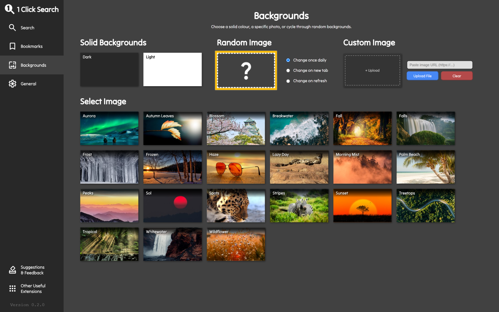

# 1 Click Search

A clean, customizable New Tab page for Chrome that puts all your favorite search bars, a live clock, and your bookmarks in one place.


---

## What It Does

- **Search Any Site in One Click:** Add a search bar from literally website on the internet right to your home page, add as many or as few as you like.
- **Open Websites Directly:** Type a web address (like `github.com` or `reddit.com`) into any search bar to go straight to that site instead of searching.
- **Live Clock & Date:** Display the time and date above your search bars in either 12-hour or 24-hour format.
- **Two Bookmark Columns:** Keep your most-visited sites neatly organized on the left and right sides of the screen.
- **Drag & Drop Right on the Home Page:** Grab a search icon or bookmark to reorder it, or drop it onto the trash bin to remove it.
- **Custom Backgrounds & Blur:** Pick from built-in nature and minimal wallpapers, switch to a solid light/dark look, rotate backgrounds daily or on every new tab, or upload your own photo and adjust the blur.
- **Easy Backup:** Copy or save your entire setup as a file so you can restore it or move it to another computer anytime.

---

## Quick Tips & Shortcuts

- Press **`/`** anywhere on the New Tab page to jump straight to the top search box.
- Press **`↑`** or **`↓`** while typing to move your search text to a different search bar.
- Press **`Esc`** to clear a search box.
- **Left-click the clock** to open Search settings, or **right-click the clock** for General settings.
- **Right-click any search icon or bookmark** to jump directly to its settings page.

---

## How to Install Manually

1. Download or clone this repository to your computer:
   ```bash
   git clone https://github.com/JJs-Code/1-Click-Search.git
   ```
2. Open Chrome (or Edge/Brave) and go to `chrome://extensions`.
3. Turn on **Developer mode** in the top-right corner.
4. Click **Load unpacked** and select the **`extension`** folder inside the downloaded repository.
5. Open a new tab to start using **1 Click Search**.

---

## Screenshots

### Search Settings


### Backgrounds


---

## Links

- **GitHub:** https://github.com/JJs-Code/1-Click-Search
- **Chrome Web Store:** https://chromewebstore.google.com/detail/npodgfdmhifnkabgfonfgepjibdjibpc
